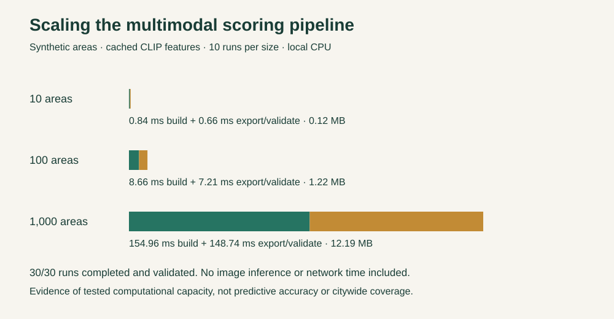

# CLIP prototype: presentation evidence



The historical prototype now combines actual frozen CLIP image features and ACS indicators. It is a provisional support-priority index, not a trained or validated gentrification forecast.

## Dedicated scalability evaluation

Measured on macOS arm64, Python 3.11.13, one process. Ten repetitions at each size after one warm-up; synthetic copies of a real input template with distinct IDs. Inputs use precomputed image features. Every output is parsed, schema-validated, and checked for the expected number of scored commercial areas.

| Areas / pairs | Median score/build | Median export/validate | Output | Errors |
| ---: | ---: | ---: | ---: | ---: |
| 10 | 0.84 ms | 0.66 ms | 0.12 MB | 0/10 |
| 100 | 8.66 ms | 7.21 ms | 1.22 MB | 0/10 |
| 1000 | 154.96 ms | 148.74 ms | 12.19 MB | 0/10 |

The benchmark exposed a repeated scan of all image pairs for each area. Indexing pairs by area reduced the measured 1,000-area median build time from 313.49 ms to 154.96 ms (about 2× faster). These are local sequential runs, not a controlled hardware study. Performance is not perfectly linear; validation, memory allocation, and output size still grow. At 1,000 areas the JSON is 12.19 MB, supporting a next step of loading areas on demand.

**Suggested slide claim:** “We tested the scoring/export pipeline at 10, 100, and 1,000 areas with cached visual features. All 30 runs passed validation. At 1,000 areas, median scoring took 155 ms and export/validation took 149 ms on a local CPU.”

Image acquisition, image inference, model startup, frontend delivery and production concurrency are excluded. This demonstrates a tested scale, not unlimited scalability.

## Real image inference and grounding checks

- Four actual images / two historical pairs encoded with frozen OpenAI CLIP ViT-B/32 on CPU: 10.26 seconds measured inside extraction. No paid API calls. This is a tiny pilot, not a throughput scaling curve.
- Same four images on the next cached extraction: four cache hits, zero encodes, 0.98 ms inside extraction. Process startup/import time excluded; do not advertise this as end-to-end latency.
- Identical-embedding control returned visual difference 0.
- Real commercial tract 06037601401: combined score 16.062558; setting visual difference to zero gives 14.827869 with numerical inputs/weights fixed. Actual image contribution: 1.234689 points. The evaluation rebuilds the bundle with zero visual features and checks that difference.
- A different numerical-only baseline, renormalizing numerical weights to sum to one, is 18.534836. This is not the same comparison as zeroing visual input.
- Visual-weight sensitivity, preserving the relative numerical weights: 0% → 18.53; 10% → 17.30; 20% → 16.06; 30% → 14.83. More image weight does not always increase the score.
- Only one of two sampled tracts supports a combined assessment. The residential tract failed exact historical boundary equality and remains unrated. This is a conservative comparability gate, not proof of a substantive boundary change.
- The commercial score sensitivity range is 16.06–66.06 when affordability pressure varies within the configured ACS bounds. It is not a confidence interval; visual reliability and weight uncertainty are not included.

## Accuracy: what can and cannot be claimed

The earlier vision observation task agreed with human reference labels on 11/12 images (91.7%), but an always-absent baseline also achieved 91.7%. No positive reference examples were present, so positive recall cannot be estimated. This is a different model/task from CLIP and is not CLIP accuracy.

No held-out outcome labels exist for the combined index, so accuracy, F1, AUC, and predictive power of gentrification risk are currently unmeasured. Inglewood’s development history motivates the case study; it cannot independently validate these scores. For the hackathon, lead with the real multimodal ablation, transparent sources, sensitivity results, and dedicated scale benchmark. A future predictive evaluation should define an independently observed later outcome and compare numerical-only and combined models on the same held-out areas/time period.

## Reproduce

```sh
.venv/bin/python -m youseela.clip_evaluation --sizes 10,100,1000 --runs 10
.venv/bin/python -m youseela.vision.clip_features --manifest data/curated/clip-jobs.json --report artifacts/clip-cache-inference.json
```

Reports: [scale and ablation](../artifacts/clip-evaluation.json), [before indexing](../artifacts/clip-evaluation-before-index.json), [first inference](../artifacts/clip-inference.json), [cached inference](../artifacts/clip-cache-inference.json).
